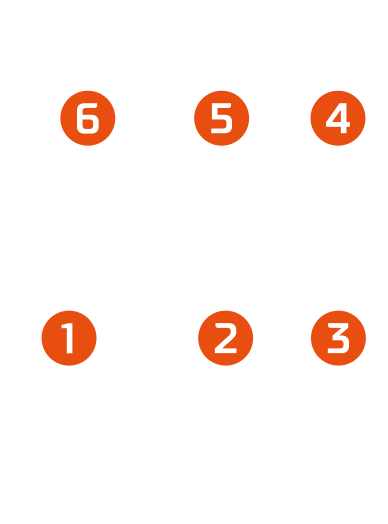

## Required items to make use of ActivePedal Sport

For single ActivePedal system system with one or two passive pedals:

* **ActivePedal Sport**
* **SC-Link Hub**
* A fully functioning simracing system
	* A sturdy sim racing rig
	* Gaming computer with an available USB port
	* Steering wheel
	* [ActivePedal compatible passive pedals](Specifications.md#activepedal-tuner-compatible-passive-pedals)

For systems with multiple ActivePedals:

* 2 or more ActivePedal Sport, ActivePedal Pro or ActivePedal Ultimate
* SC-Link Hub
* Ethernet swich with enough ports for SC-Link Hub and ActivePedals

## Optional items

* ActivePedal Base plate. This may ease installation on rig and improve ergonomics

## ActivePedal Sport package contents
 
 

 
 

| Item                     | Qty   |
| ------------------------ | ----- |
| 1. ActivePedal Sport     | 1 pc  |
| 2. Power adapter         | 1 pc  |
| 3. AC power cord         | 2 pcs |
| 4. RJ45 cable            | 1 pc  |
| 5. Hex key   			   | 1 pc  |
| 6. Screw kit   &ensp; &ensp; - M5x20 allen head bolts   &ensp; &ensp; - M5x30 allen head bolts   &ensp; &ensp; - M5 washers, small   &ensp; &ensp; - M5 washers, large   &ensp; &ensp; - M5 nylock nut   &ensp; &ensp; - M5 t-slot nut, 8mm slot   |   7 pcs   7 pcs   7 pcs   7 pcs   7 pcs   7 pcs  |

