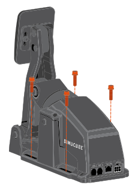
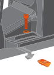
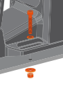

## ActivePedal Sport mounting 

ActivePedal Sport is mounted to the rig or baseplate by clamping it down using 4 pcs of M5 threaded screws with washers. 

For ActivePedal Sport footprint dimensions, see [specifications](Specifications.md).

!!! Info
    All four (4) screws must be used to ensure strong installation. Tighten screws to sufficient torque (~3 Nm).

## Mounting with Simucube Baseplate

Simucube Baseplate is a optional accessory that provides easy mounting, adjustability and comfort when using certain pedals. 

For more info and assembly instructions, see [Simucube Baseplate](../ActivePedal/Baseplate.md).

## Mounting directly to the rig

ActivePedal Sport may be mounted also without Baseplate directly to the rig. Installation method depends on the rig model and construction. Most common methods are illustrated below.

<figure markdown>
{ width="350" }
<figcaption>Mounting on slotted profile with T nuts</figcaption>
</figure>

<figure markdown>
{ width="350" }
<figcaption>Mounting on through-hole plate</figcaption>
</figure>

